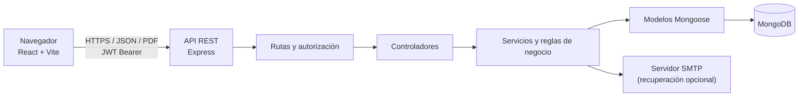

# Sistema de gestión y evaluación de instructores SENA

Aplicación web académica para gestionar perfiles, fichas, inscripciones,
horarios y novedades de formación, y para recibir evaluaciones de instructores.
Incluye paneles para aprendices, instructores y coordinación.

> **Estado:** prototipo académico funcional en desarrollo. No es un sistema
> oficial del SENA ni debe utilizarse en producción sin revisar seguridad,
> privacidad, operación y requisitos institucionales.

Presentación: [pitch del proyecto](./docs/pitch-gestor-evaluacion-instructores-sena.pptx).

## Contenido

- [Situación problema](#situación-problema)
- [Solución propuesta](#solución-propuesta)
- [Objetivos](#objetivos)
- [Alcance](#alcance)
- [Historias de usuario](#historias-de-usuario)
- [Requisitos funcionales](#requisitos-funcionales)
- [Requisitos no funcionales](#requisitos-no-funcionales)
- [Reglas de negocio](#reglas-de-negocio)
- [Funciones](#funciones)
- [Guía rápida por rol](#guía-rápida-por-rol)
- [Tecnologías y estructura](#tecnologías-y-estructura)
- [Arquitectura de la aplicación](#arquitectura-de-la-aplicación)
- [Datos y privacidad](#datos-y-privacidad)
- [Requisitos del entorno](#requisitos-del-entorno)
- [Ejecución local](#ejecución-local)
- [Configuración](#configuración)
- [Datos de prueba](#datos-de-prueba)
- [Crear el primer coordinador](#crear-el-primer-coordinador)
- [API](#api)
- [Matriz de permisos](#matriz-de-permisos)
- [Ejemplos de API](#ejemplos-de-api)
- [Migraciones](#migraciones)
- [Pruebas](#pruebas)
- [Validación de historias de usuario](#validación-de-historias-de-usuario)
- [Despliegue](#despliegue)
- [Seguridad y limitaciones](#seguridad-y-limitaciones)
- [Política de datos pendiente](#política-de-datos-pendiente)
- [Respaldo y recuperación](#respaldo-y-recuperación)
- [Próximos pasos](#próximos-pasos)
- [Documentación relacionada](#documentación-relacionada)
- [Licencia](#licencia)

## Situación problema

Aprendices y coordinación necesitan consultar quién orienta cada sesión, en
qué horario y ambiente, y conocer las novedades que puedan afectar la
formación. Cuando horarios, cambios y observaciones se comunican por medios
dispersos, es difícil mantener una referencia común y dar seguimiento a la
experiencia formativa.

Las evaluaciones también requieren controles: deben corresponder a un
instructor y ficha relacionados, evitar participaciones duplicadas y reducir
la exposición de respuestas individuales. El proyecto aborda estas necesidades
con una aplicación centralizada, permisos por rol y resultados consolidados.

## Solución propuesta

La aplicación ofrece una interfaz web para tres roles y una API REST que
persiste la información en MongoDB. Coordinación gestiona perfiles, fichas,
inscripciones, horarios y novedades; los aprendices consultan su formación y
evalúan instructores asignados; los instructores consultan su actividad,
resultados disponibles y un informe PDF.

La rúbrica vigente contiene ocho criterios en tres categorías. Las respuestas
no guardan el identificador del aprendiz y la participación se registra por
separado para evitar duplicados. Los resultados y comentarios solo se exponen
para grupos de al menos cinco evaluaciones. Estas medidas reducen la
identificación directa, pero no garantizan anonimato absoluto frente a
administradores, registros o información que permita correlacionar respuestas.

## Objetivos

### Objetivo general

Desarrollar una aplicación web por capas que centralice la consulta de horarios,
la comunicación de novedades y la evaluación de instructores, con acceso por
roles y persistencia en MongoDB.

### Objetivos específicos

1. Permitir a coordinación gestionar perfiles, fichas, inscripciones y sesiones.
2. Facilitar al aprendiz la consulta de sus fichas, horarios, instructores y
   novedades.
3. Implementar evaluaciones con rúbrica, controlar duplicados y proteger la
   exposición de resultados pequeños.
4. Proporcionar a instructores y coordinación acceso a métricas y
   retroalimentación consolidada según el umbral.
5. Separar presentación, comunicación HTTP, reglas de negocio y persistencia
   para facilitar el mantenimiento y las pruebas.

## Alcance

### Incluido en la versión actual

- Inicio de sesión y paneles para coordinación, instructor y aprendiz.
- Recuperación de contraseña por correo con enlace temporal de un solo uso.
- Autorización de operaciones según rol.
- Administración de perfiles de instructores y aprendices.
- Gestión de fichas, inscripciones, horarios semanales y novedades manuales.
- Evaluación de instructores por aprendices elegibles y consulta de resultados
  agregados con el mínimo de respuestas requerido.
- Informe PDF de instructor con promedios y retroalimentación anónima disponible.
- Importación opcional y protegida de datos sintéticos en entornos no productivos.

### Fuera del alcance actual

- Integración o sincronización con sistemas institucionales oficiales.
- Sincronización automática de horarios, asistencia o novedades.
- Notificaciones por SMS o push y segundo factor de autenticación.
- Aplicación móvil nativa, funcionamiento sin conexión o soporte multiinstitución.
- Flujos institucionales de aprobación o seguimiento formal de planes de mejora.
- Garantía de anonimato frente a administradores o análisis de correlación.
- Monitoreo, respaldos, disponibilidad y operación productiva administrados por
  la aplicación.

## Historias de usuario

| ID | Actor | Historia | Criterio de aceptación |
|---|---|---|---|
| HU-01 | Usuario registrado | Iniciar sesión para acceder a las funciones de mi rol. | Credenciales válidas; rutas protegidas rechazan sesiones ausentes o inválidas. |
| HU-02 | Coordinador | Crear, editar y desactivar perfiles de instructores y aprendices. | El rol se valida, los correos no se duplican y la contraseña inicial cumple la longitud requerida. |
| HU-03 | Coordinador | Crear y mantener fichas, aprendices inscritos y sesiones. | Horas válidas, final posterior al inicio y sin traslapes en el mismo día. |
| HU-04 | Coordinador o instructor | Publicar novedades asociadas a una ficha. | La novedad incluye tipo y mensaje, y aparece en la consulta del aprendiz. |
| HU-05 | Aprendiz | Consultar mis fichas y horarios. | Solo aparecen fichas inscritas, sesiones y novedades relacionadas. |
| HU-06 | Aprendiz | Evaluar a un instructor de mi ficha. | Instructor asignado, rúbrica respondida, comentario válido y sin duplicados en el periodo. |
| HU-07 | Instructor | Consultar mis fichas y actualizar mi estado operativo. | Solo consulta su información y selecciona un estado permitido. |
| HU-08 | Instructor o coordinador | Consultar resultados consolidados disponibles. | No se exponen comentarios ni promedios de grupos con menos de cinco respuestas. |
| HU-09 | Coordinador | Consultar métricas institucionales. | Los datos se obtienen de la API y el acceso requiere rol de coordinación. |
| HU-10 | Usuario registrado | Recuperar mi contraseña si no puedo ingresar. | Respuesta que no revela si el correo existe; enlace de un solo uso y sesiones anteriores invalidadas al cambiarla. |
| HU-11 | Instructor | Descargar un informe de mis evaluaciones. | PDF con promedios y retroalimentación disponible, respetando anonimato y umbral. |

Las historias describen las funciones de esta versión; no implican
notificaciones automáticas ni procesos institucionales externos.

## Requisitos funcionales

| ID | Requisito |
|---|---|
| RF-01 | Autenticar usuarios y permitir consultar su perfil mediante la API. |
| RF-02 | Autorizar las operaciones protegidas según los roles coordinador, instructor y aprendiz. |
| RF-03 | Permitir a coordinación listar, crear, editar y desactivar perfiles de aprendices e instructores. |
| RF-04 | Permitir a coordinación listar, crear, editar y desactivar fichas. |
| RF-05 | Asociar aprendices, periodos, instructores y sesiones a las fichas. |
| RF-06 | Validar horas y fechas, y rechazar sesiones traslapadas en un mismo día. |
| RF-07 | Permitir al aprendiz consultar sus fichas, sesiones y novedades. |
| RF-08 | Permitir al instructor consultar sus fichas y horarios. |
| RF-09 | Permitir a coordinación e instructores registrar novedades admitidas. |
| RF-10 | Permitir a aprendices elegibles evaluar instructores mediante la rúbrica vigente. |
| RF-11 | Limitar a una evaluación por aprendiz, instructor, ficha y periodo. |
| RF-12 | Calcular promedios y actualizar métricas de evaluación del instructor. |
| RF-13 | Agrupar resultados por instructor, ficha y periodo y ocultarlos antes de cinco respuestas. |
| RF-14 | Permitir a coordinación consultar perfiles, fichas y métricas de gestión. |
| RF-15 | Ofrecer una ruta de salud para verificar que la API responde. |
| RF-16 | Permitir previsualizar y confirmar datos sintéticos solo en entornos habilitados no productivos. |
| RF-17 | Permitir solicitar recuperación de contraseña sin revelar si una cuenta existe. |
| RF-18 | Permitir cambiar la contraseña con enlace de un solo uso que vence a los 30 minutos e invalidar sesiones JWT previas. |
| RF-19 | Permitir al instructor autenticado descargar un PDF con sus promedios y comentarios de grupos publicables. |

## Requisitos no funcionales

1. **Arquitectura mantenible:** separar interfaz, servicios HTTP, rutas,
   controladores, lógica de negocio y persistencia.
2. **Control de acceso:** validar token y rol en el backend; no confiar solo en
   ocultar controles en la interfaz.
3. **Protección de contraseñas:** almacenar hashes scrypt y no devolver la
   contraseña en consultas normales.
4. **Validación:** validar datos en la API y en los esquemas Mongoose para los
   casos cubiertos.
5. **Privacidad:** no guardar el identificador del aprendiz en la respuesta de
   evaluación ni publicar agregados antes del umbral; no prometer anonimato
   absoluto.
6. **Configuración segura:** mantener URI, secretos y credenciales en variables
   de entorno, fuera del repositorio.
7. **Separación de entornos:** bloquear importación de datos y migraciones
   protegidas en producción.
8. **Usabilidad:** mostrar estados de carga y error en flujos principales, con
   una interfaz adaptable.
9. **Pruebas:** permitir ejecutar las pruebas backend contra MongoDB temporal
   sin leer ni modificar la base configurada para la aplicación.
10. **Operación:** la disponibilidad, respaldos, monitoreo y recuperación ante
    desastres dependen del entorno de despliegue.

## Reglas de negocio

- Los roles son `coordinador`, `instructor` y `aprendiz`. Coordinación crea
  cuentas de instructor y aprendiz; su propio perfil se provisiona aparte.
- La contraseña inicial creada desde coordinación debe tener al menos 12
  caracteres.
- Una ficha tiene código único, programa, periodo e inscripciones; sus sesiones
  pueden asignar instructores distintos.
- La hora de fin debe ser posterior a la de inicio y los bloques del mismo día
  no se pueden traslapar.
- Los tipos de novedad son `cancelacion`, `cambio_horario`, `cambio_ambiente` y
  `general`.
- Solo aprendices inscritos en una ficha activa pueden evaluar instructores
  asignados a esa ficha; coordinación no responde evaluaciones.
- Las respuestas de la rúbrica son enteros de 1 a 5 o “No me consta / No
  aplica”, cuando corresponda.
- El comentario es obligatorio y debe tener entre 10 y 1000 caracteres.
- Una participación por aprendiz, instructor, ficha y periodo; los resultados
  se agrupan y publican desde cinco respuestas.
- La desactivación de perfiles y fichas es lógica, no implica borrado físico.

## Funciones

| Rol | Funciones principales |
|---|---|
| Aprendiz | Consultar sus fichas, horarios, instructores y novedades; evaluar instructores asignados a su formación. |
| Instructor | Consultar sus fichas y horarios, actualizar su estado operativo, ver resultados consolidados y descargar un informe PDF. |
| Coordinación | Administrar perfiles de aprendices e instructores, gestionar fichas e inscripciones, publicar novedades y consultar métricas. |

Las novedades registradas pueden ser cancelaciones, cambios de horario,
cambios de ambiente o avisos generales. La aplicación no sincroniza
automáticamente datos con sistemas institucionales externos.

### Evaluaciones e informes

- La rúbrica actual tiene ocho criterios en tres categorías y calificaciones
  de 1 a 5; algunos criterios pueden marcarse como no aplicables.
- El aprendiz debe estar inscrito en la ficha y el instructor debe estar
  asignado a ella.
- Solo se permite una participación por aprendiz, instructor, ficha y periodo.
- El comentario debe tener entre 10 y 1000 caracteres.
- Los promedios y comentarios se publican agrupados cuando el grupo alcanza al
  menos cinco evaluaciones.
- El informe PDF del instructor contiene promedios generales y por categoría,
  además de comentarios anónimos de grupos que cumplen ese umbral.

## Guía rápida por rol

1. **Aprendiz:** inicia sesión, consulta las fichas y sesiones inscritas, abre
   la evaluación de un instructor asignado, responde la rúbrica y envía un
   comentario. Si ya participó para ese instructor, ficha y periodo, la API
   rechaza el duplicado.
2. **Instructor:** consulta sus fichas y horarios, cambia su estado operativo,
   revisa la pestaña de retroalimentación anónima y usa **Descargar informe
   PDF** para guardar el consolidado disponible.
3. **Coordinación:** administra perfiles de aprendices e instructores, crea y
   mantiene fichas y horarios, consulta métricas y registra novedades. La
   importación de datos sintéticos es opcional, requiere habilitación y una
   confirmación tras revisar la vista previa.

Esta guía es textual: el repositorio no incluye capturas de pantalla de los
paneles. Antes de agregarlas, se deben usar datos ficticios y ocultar correos,
documentos, tokens y cualquier dato personal.

## Tecnologías y estructura

| Área | Tecnología |
|---|---|
| Interfaz | React 18, JavaScript/JSX |
| Desarrollo y compilación frontend | Vite 5 |
| Estilos e iconos | Tailwind CSS 3, Lucide React |
| API | Node.js, Express 4 |
| Base de datos | MongoDB, Mongoose 8 |
| Autenticación | JWT; contraseñas con hash scrypt |
| Correo de recuperación | Nodemailer y SMTP |
| Informes | PDFKit |
| Pruebas backend | Node.js Test Runner, mongodb-memory-server |

```text
src/
├── components/   Vistas y componentes de interfaz
├── hooks/        Estado y carga de datos para los paneles
├── services/     Cliente HTTP y operaciones de dominio
└── App.jsx       Composición de la aplicación y paneles por rol

backend/
├── routes/       Rutas y permisos
├── controllers/  Solicitudes y respuestas HTTP
├── services/     Reglas de negocio
├── models/       Esquemas Mongoose
├── middlewares/  Autenticación, autorización y errores
├── config/       Conexión, correo, seed y migraciones
└── test/         Pruebas automatizadas
```

El backend sigue el flujo `ruta -> controlador -> servicio -> modelo`.
`backend/app.js` configura Express y las rutas; `backend/server.js` conecta la
base de datos e inicia el servidor.

## Arquitectura de la aplicación



El navegador usa `VITE_API_URL` como dirección base; el backend controla
autenticación, roles y acceso al recurso solicitado. Para PDFs, el endpoint
devuelve el archivo binario y no una respuesta JSON. El correo solo se utiliza
en recuperación de contraseña si SMTP está configurado.

## Datos y privacidad

Los perfiles y datos académicos se guardan en colecciones separadas:

- Perfiles: `instructores`, `aprendices` y `coordinadores`. Cada perfil contiene
  sus propios datos de acceso; las contraseñas se guardan como hashes.
- Datos académicos: periodos, fichas, inscripciones, horarios y novedades.
- Evaluaciones: documentos de evaluación, respuestas por criterio y
  participaciones. Las respuestas no guardan el identificador del aprendiz;
  la participación separada se usa para evitar duplicados.

La separación y el umbral reducen la exposición de respuestas, pero no
garantizan anonimato absoluto frente a personas con acceso a la base, registros
o información que permita correlacionar respuestas. El modelo actual está
documentado en el [diagrama de datos MongoDB](./docs/modelo-datos-mongodb.md).
El [modelo propuesto](./docs/modelo-propuesto-colecciones-mongodb.md) describe
posibles extensiones, no todas implementadas.

## Requisitos del entorno

- Node.js y npm instalados.
- Una base MongoDB local o MongoDB Atlas accesible desde el backend.
- Dos terminales para ejecutar frontend y backend.

El proyecto no declara una versión de Node.js mediante `engines`; se recomienda
una versión LTS compatible con las dependencias. En PowerShell de Windows,
puede ser necesario ejecutar `npm.cmd` en lugar de `npm`.

## Ejecución local

1. Instala las dependencias desde la raíz del repositorio:

   ```powershell
   npm.cmd install
   npm.cmd install --prefix backend
   ```

2. Crea la configuración local del backend:

   ```powershell
   Copy-Item backend\.env.example backend\.env
   ```

   Edita `backend/.env` y configura, como mínimo, `MONGO_URI` y un `JWT_SECRET`
   propio de al menos 32 caracteres. No reutilices secretos de otro entorno.

3. En una terminal, inicia el backend:

   ```powershell
   npm.cmd run dev --prefix backend
   ```

   Por defecto, la API queda disponible en `http://localhost:5000`. Comprueba
   su estado en `http://localhost:5000/api/health`.

4. En otra terminal, desde la raíz, inicia el frontend:

   ```powershell
   npm.cmd run dev
   ```

   Abre la dirección que indique Vite, normalmente
   `http://localhost:5173`. El frontend usa por defecto la API local; para otra
   dirección define `VITE_API_URL`, incluyendo el prefijo `/api`.

La aplicación no crea cuentas automáticamente al arrancar. Para datos de
demostración, consulta [Datos de prueba](#datos-de-prueba).

## Configuración

Las variables del backend se configuran en `backend/.env`. La plantilla está en
[`backend/.env.example`](./backend/.env.example).

| Variable | Uso |
|---|---|
| `PORT` | Puerto HTTP; por defecto `5000`. |
| `MONGO_URI` | URI de la base MongoDB. Trátala como confidencial. |
| `JWT_SECRET` | Secreto aleatorio de al menos 32 caracteres para firmar tokens. |
| `NODE_ENV` | Entorno; usa `development` localmente y `production` en producción. |
| `CLIENT_ORIGINS` | Orígenes CORS permitidos, separados por comas. |
| `FRONTEND_URL` | URL del frontend usada en enlaces de recuperación. En producción debe usar HTTPS. |
| `SMTP_HOST`, `SMTP_PORT`, `SMTP_SECURE` | Servidor, puerto y modo TLS del proveedor de correo. |
| `SMTP_USER`, `SMTP_PASS`, `SMTP_FROM` | Credenciales SMTP y remitente verificado. |
| `DEMO_INITIAL_PASSWORD` | Contraseña inicial del seed; al menos 12 caracteres y solo para pruebas locales. |
| `ENABLE_TEST_DATA_IMPORT` | Debe ser `true` para habilitar la importación de datos sintéticos fuera de producción. |
| `VITE_API_URL` | URL base de la API para el frontend, por ejemplo `http://localhost:5000/api`. |

Genera un secreto localmente:

```powershell
node -e "console.log(require('crypto').randomBytes(32).toString('hex'))"
```

Guárdalo solo en `backend/.env` o en el gestor de secretos del entorno. No
incluyas credenciales ni URI privadas en el repositorio.

### Recuperación de contraseña

La recuperación funciona para aprendices, instructores y coordinación. La
persona ingresa el correo de su perfil; el sistema busca ese correo en las tres
colecciones, sin depender de la pestaña de rol seleccionada al iniciar sesión.
Nodemailer envía un enlace de un solo uso que vence a los 30 minutos; MongoDB
conserva el hash del token, no el token original. Al cambiar la contraseña se
invalidan tokens pendientes y sesiones JWT anteriores. La respuesta de
solicitud no revela si el correo está registrado.

#### Configurar Gmail para envío real

1. Utiliza una cuenta de Gmail autorizada para enviar correos del sistema. Si
   es una cuenta Google Workspace institucional, el administrador puede
   deshabilitar SMTP o contraseñas de aplicación; en ese caso solicita un
   proveedor aprobado.
2. Activa la verificación en dos pasos de la cuenta remitente y crea una
   **contraseña de aplicación** desde la configuración de seguridad de Google.
   Usa esa contraseña de aplicación, no la contraseña normal de la cuenta.
3. En `backend/.env` configura:

   ```dotenv
   SMTP_HOST=smtp.gmail.com
   SMTP_PORT=587
   SMTP_SECURE=false
   SMTP_USER=tu-cuenta@gmail.com
   SMTP_PASS=contraseña-de-aplicación-de-16-caracteres
   SMTP_FROM=tu-cuenta@gmail.com
   FRONTEND_URL=http://localhost:5173
   ```

   Escribe la contraseña de aplicación sin los espacios que Google pueda
   mostrar. El remitente `SMTP_FROM` debe ser la cuenta autenticada o una
   dirección que Gmail permita enviar. Mantén `SMTP_PASS` solo en el `.env`
   local o en el gestor de secretos; nunca lo envíes por chat ni lo subas a Git.
4. Reinicia el backend para que cargue la configuración. Abre **¿Olvidaste tu
   contraseña?**, introduce el correo de una cuenta existente de cualquiera de
   los tres roles y revisa la bandeja de entrada y spam.
5. Abre el enlace recibido en la aplicación, crea una contraseña de 12 a 128
   caracteres e inicia sesión de nuevo. El enlace expira a los 30 minutos y no
   puede reutilizarse.

Para un despliegue, configura las mismas variables SMTP en el entorno del
backend (por ejemplo, en Render), y cambia `FRONTEND_URL` por la URL HTTPS
exacta del frontend publicado. `localhost` solo funciona en pruebas locales.
La configuración actual del entorno local no incluye credenciales SMTP; por
eso el envío real no puede funcionar hasta que se completen esos valores.

Si SMTP no está configurado, la API devuelve un error explícito de servicio no
disponible; si el proveedor rechaza el envío, muestra un error de entrega sin
exponer la contraseña SMTP. Los límites de solicitudes se almacenan en memoria
por proceso. Antes de escalar a varias instancias se necesita un almacén
compartido y configurar correctamente la confianza del proxy inverso.

## Datos de prueba

### Seed

El seed se ejecuta manualmente y solo si el entorno no es producción, la base
está vacía y `DEMO_INITIAL_PASSWORD` tiene al menos 12 caracteres. Verifica
cuidadosamente `MONGO_URI` antes de ejecutarlo:

```powershell
$env:DEMO_INITIAL_PASSWORD = "una-clave-local-segura"
npm.cmd run seed --prefix backend
```

No uses el seed en una base con datos que debas conservar.

### Crear el primer coordinador

No existe una ruta pública para crear coordinadores, y el panel de
administración solo crea perfiles de instructor y aprendiz. Para aprovisionar
el primer coordinador se agregó un comando de operador que solicita nombre,
correo y contraseña en una terminal interactiva. La contraseña se escribe sin
mostrarla y se solicita dos veces; no se acepta por argumento de consola ni se
guarda en el repositorio.

El comando solo crea el perfil si todavía no existe un coordinador ni se ha
usado antes el aprovisionamiento inicial. Guarda una marca única en MongoDB
para prevenir ejecuciones concurrentes o un segundo bootstrap. No modifica ni
restablece cuentas existentes.

**Antes de ejecutarlo:** verifica `MONGO_URI`, confirma el entorno y asegúrate
de tener autorización sobre esa base. En producción, el operador debe tener
acceso controlado a las credenciales de MongoDB y habilitar dos confirmaciones
temporales. Ejecuta desde PowerShell:

```powershell
$env:ALLOW_COORDINATOR_BOOTSTRAP = "true"
# Solo en producción, durante la ejecución autorizada:
$env:ALLOW_PRODUCTION_COORDINATOR_BOOTSTRAP = "true"
npm.cmd run coordinator:bootstrap --prefix backend
Remove-Item Env:ALLOW_COORDINATOR_BOOTSTRAP
Remove-Item Env:ALLOW_PRODUCTION_COORDINATOR_BOOTSTRAP -ErrorAction SilentlyContinue
```

El programa también exige escribir una confirmación explícita; en producción
solicita `CREAR COORDINADOR EN PRODUCCION`. Si la base ya contiene un
coordinador, no crea otro: usa la recuperación por correo. No ejecutes el
bootstrap en una base compartida sin autorización y respaldo.

Para una demostración desechable también está disponible el [seed de prueba](#seed),
que crea perfiles y datos sintéticos en una base vacía no productiva. No es el
mecanismo para aprovisionar coordinación en producción.

### Recuperar una cuenta de coordinación

La recuperación de contraseña existente también admite perfiles coordinadores:

1. Configura SMTP según [Recuperación de contraseña](#recuperación-de-contraseña).
2. Desde la pantalla de acceso, solicita recuperación con el correo de
   coordinación y abre el enlace recibido.
3. Define una contraseña de 12 a 128 caracteres. El enlace vence a los 30
   minutos y solo se puede usar una vez; el cambio invalida sesiones previas.

La respuesta no revela si el correo está registrado. Si el coordinador perdió
acceso al correo o SMTP no está disponible, el sistema no tiene una ruta de
omisión ni permite restablecer la cuenta desde el panel. El responsable de
infraestructura debe restaurar primero el acceso al correo o definir un
procedimiento excepcional, autorizado y auditado; no se debe añadir una ruta
pública para cambiar contraseñas de coordinación.

### Importación desde coordinación

La importación de datos sintéticos es opcional, solo para entornos no
productivos. Requiere `ENABLE_TEST_DATA_IMPORT=true`, una sesión de
coordinación, una base aislada y revisar la vista previa antes de confirmar.

## API

La API tiene el prefijo `/api`. Las rutas protegidas requieren un token JWT en
`Authorization: Bearer <token>` y, cuando se indica, el rol correspondiente.

| Método | Ruta | Acceso | Descripción |
|---|---|---|---|
| `GET` | `/api/health` | Público | Estado del servicio. |
| `POST` | `/api/auth/login` | Público | Iniciar sesión. |
| `POST` | `/api/auth/password-reset` | Público, limitado por IP | Solicitar recuperación. |
| `POST` | `/api/auth/password-reset/confirm` | Público, limitado por IP | Cambiar contraseña con token. |
| `GET` | `/api/auth/me/:id` | Usuario autenticado | Consultar perfil. |
| `GET` | `/api/instructors` | Público | Listar instructores. |
| `GET` | `/api/instructors/metrics/summary` | Coordinador | Consultar métricas institucionales. |
| `GET` | `/api/instructors/me/report.pdf` | Instructor | Descargar su informe PDF. |
| `GET` | `/api/instructors/:id` | Coordinador o el propio instructor | Consultar perfil y resultados disponibles. |
| `PATCH` | `/api/instructors/:id/status` | Coordinador o el propio instructor | Actualizar estado operativo. |
| `GET` | `/api/evaluations/rubric` | Aprendiz | Consultar la rúbrica vigente. |
| `POST` | `/api/evaluations` | Aprendiz | Registrar evaluación. |
| `GET` | `/api/evaluations/recent` | Coordinador | Consultar resultados recientes disponibles. |
| `GET` | `/api/evaluations/instructor/:instructorId` | Coordinador o instructor autorizado | Consultar resultados consolidados. |
| `GET`, `POST` | `/api/management/users` | Coordinador | Listar y crear perfiles. |
| `PATCH`, `DELETE` | `/api/management/users/:id` | Coordinador | Actualizar o desactivar un perfil. |
| `GET`, `POST` | `/api/management/fichas` | Coordinador | Listar y crear fichas. |
| `PATCH`, `DELETE` | `/api/management/fichas/:id` | Coordinador | Actualizar o desactivar una ficha. |
| `POST` | `/api/management/fichas/:fichaId/novedades` | Coordinador o instructor | Publicar una novedad. |
| `GET` | `/api/management/learner/schedule` | Aprendiz | Consultar fichas y horarios propios. |
| `GET` | `/api/management/instructor/fichas` | Instructor | Consultar fichas propias. |
| `POST` | `/api/management/test-imports/preview` | Coordinador, opción habilitada | Previsualizar datos sintéticos. |
| `POST` | `/api/management/test-imports/confirm` | Coordinador, opción habilitada | Confirmar importación revisada. |

Los campos de cada solicitud y respuesta se definen en los controladores y
servicios del backend.

## Matriz de permisos

Todos los permisos se verifican en el backend. “Propio” significa que el
recurso pertenece al usuario autenticado; no basta con cambiar el ID enviado
por el cliente.

| Operación | Público | Aprendiz | Instructor | Coordinación |
|---|---:|---:|---:|---:|
| Iniciar sesión o solicitar recuperación | Sí | Sí | Sí | Sí |
| Listar instructores | Sí | Sí | Sí | Sí |
| Consultar horario propio | No | Sí | No | No |
| Consultar fichas propias | No | No | Sí | No |
| Consultar perfil propio | No | Sí | Sí | Sí |
| Consultar perfil de otro instructor | No | No | No | Sí |
| Registrar evaluación | No | Sí, elegible | No | No |
| Consultar resultados propios del instructor | No | No | Sí | Sí |
| Descargar informe PDF del instructor autenticado | No | No | Sí | No |
| Consultar métricas institucionales y evaluaciones recientes | No | No | No | Sí |
| Crear, editar o desactivar perfiles de aprendiz/instructor | No | No | No | Sí |
| Crear, editar o desactivar fichas | No | No | No | Sí |
| Publicar novedad en ficha | No | No | Solo en ficha asignada | Sí |
| Previsualizar/confirmar importación sintética habilitada | No | No | No | Sí |

La ruta de actualización de estado operativo admite al propio instructor y a
coordinación. Coordinación puede consultar perfiles de cualquier rol; un
usuario no coordinador solo puede consultar su propio perfil. La matriz resume
las rutas actuales; las reglas de asignación de fichas y evaluación se vuelven
a validar en los servicios.

## Ejemplos de API

Los ejemplos usan PowerShell y `Invoke-RestMethod`, disponible en Windows. Los
valores entre `<...>` son marcadores que debes reemplazar; no pegues secretos en
el README, capturas ni repositorio. Usa datos de prueba.

### Iniciar sesión

```powershell
$api = "http://localhost:5000/api"
$login = Invoke-RestMethod -Method Post `
  -Uri "$api/auth/login" `
  -ContentType "application/json" `
  -Body (@{
    email = "<correo-de-prueba>"
    password = "<clave-local>"
    rol = "coordinador"
  } | ConvertTo-Json)

$token = $login.token
$headers = @{ Authorization = "Bearer $token" }
```

La respuesta contiene el token en `token` y el perfil sin el hash de contraseña
en `data`.

### Consultar la rúbrica y enviar una evaluación

Inicia sesión como aprendiz para estas llamadas y actualiza `$headers` con su
token (la llamada de inicio de sesión anterior usa coordinación):

```powershell
$learnerLogin = Invoke-RestMethod -Method Post `
  -Uri "$api/auth/login" `
  -ContentType "application/json" `
  -Body (@{
    email = "<correo-aprendiz-de-prueba>"
    password = "<clave-local>"
    rol = "aprendiz"
  } | ConvertTo-Json)
$headers = @{ Authorization = "Bearer $($learnerLogin.token)" }

Invoke-RestMethod -Method Get `
  -Uri "$api/evaluations/rubric" `
  -Headers $headers
```

Para enviar una evaluación, inicia sesión como aprendiz y utiliza los
identificadores de un instructor y ficha realmente asignados a su formación.
El ejemplo incluye los ocho códigos de la rúbrica actual:

```powershell
$evaluation = @{
  instructorId = "<id-instructor>"
  fichaId = "<id-ficha>"
  respuestas = @(
    @{ codigo = "dominio_tecnico"; calificacion = 5; noAplica = $false }
    @{ codigo = "metodologia"; calificacion = 4; noAplica = $false }
    @{ codigo = "evaluacion"; calificacion = 4; noAplica = $false }
    @{ codigo = "comunicacion"; calificacion = 4; noAplica = $false }
    @{ codigo = "escucha"; calificacion = 4; noAplica = $false }
    @{ codigo = "respeto_inclusion"; calificacion = 5; noAplica = $false }
    @{ codigo = "puntualidad"; calificacion = 5; noAplica = $false }
    @{ codigo = "ambiente_aprendizaje"; calificacion = 4; noAplica = $false }
  )
  comentario = "Explica los temas con claridad y responde las preguntas del grupo."
}

Invoke-RestMethod -Method Post `
  -Uri "$api/evaluations" `
  -Headers $headers `
  -ContentType "application/json" `
  -Body ($evaluation | ConvertTo-Json -Depth 5)
```

La API devuelve `201` si la evaluación se registra. Devuelve `400` ante
respuestas inválidas o incompletas, `403` si el aprendiz no es elegible y
`409` si ya participó para esa ficha, instructor y periodo.

### Descargar el PDF del instructor

Inicia sesión con un perfil instructor y guarda el archivo:

```powershell
$instructorLogin = Invoke-RestMethod -Method Post `
  -Uri "$api/auth/login" `
  -ContentType "application/json" `
  -Body (@{
    email = "<correo-instructor-de-prueba>"
    password = "<clave-local>"
    rol = "instructor"
  } | ConvertTo-Json)
$headers = @{ Authorization = "Bearer $($instructorLogin.token)" }

Invoke-WebRequest -Method Get `
  -Uri "$api/instructors/me/report.pdf" `
  -Headers $headers `
  -OutFile ".\informe-retroalimentacion.pdf"
```

La ruta requiere un instructor autenticado; devuelve `401` sin sesión válida.
La descarga no admite solicitar el PDF de otro instructor por ID.

## Migraciones

Las migraciones no se ejecutan al iniciar la aplicación. Antes de cada
migración, haz un respaldo, apunta `MONGO_URI` a una copia no productiva y
revisa el resultado. Las tareas están bloqueadas en producción; no elimines
colecciones antiguas hasta verificar los perfiles y datos migrados.

El backend incluye estos comandos:

| Comando | Confirmación requerida | Propósito |
|---|---|---|
| `migrate:roles` | `ALLOW_ROLE_COLLECTIONS_MIGRATION=true` | Migrar usuarios antiguos a perfiles por rol. |
| `migrate:roles:drop-legacy` | `ALLOW_ROLE_COLLECTIONS_MIGRATION=true` y `ALLOW_LEGACY_USERS_DROP=true` | Eliminar la colección antigua de usuarios tras verificar. |
| `migrate:academic` | `ALLOW_ACADEMIC_COLLECTIONS_MIGRATION=true` | Normalizar datos académicos existentes. |
| `migrate:accounts` | `ALLOW_ACCOUNT_EMBEDDING_MIGRATION=true` | Integrar credenciales de `cuentas` en perfiles ya separados. |
| `migrate:accounts:drop` | `ALLOW_ACCOUNT_EMBEDDING_MIGRATION=true` y `ALLOW_ACCOUNTS_DROP=true` | Eliminar `cuentas` tras verificar. |
| `migrate:participation` | `ALLOW_EVALUATION_PARTICIPATION_MIGRATION=true` | Actualizar registros/índices antiguos de participación. |

Ejemplo para una migración no destructiva, desde PowerShell y con `MONGO_URI`
apuntando a una copia aislada:

```powershell
$env:ALLOW_ROLE_COLLECTIONS_MIGRATION = "true"
npm.cmd run migrate:roles --prefix backend
```

Los pasos de eliminación exigen las dos confirmaciones indicadas en la tabla.
Cada tarea está protegida contra producción, pero eso no sustituye el respaldo,
la verificación ni la autorización del responsable de la base. Lee el código
de `backend/config/` antes de ejecutarla.

## Pruebas

Ejecuta desde la raíz:

```powershell
npm.cmd test --prefix backend
npm.cmd run build
```

Las pruebas backend usan `mongodb-memory-server` y una base temporal; no deben
leer ni modificar `MONGO_URI`. En la primera ejecución puede requerirse
descargar el binario local de MongoDB. Para previsualizar la compilación del
frontend:

```powershell
npm.cmd run preview
```

## Validación de historias de usuario

Las pruebas automatizadas actuales cubren principalmente backend. Ejecuta
`npm.cmd test --prefix backend`; los escenarios de integración usan una base
MongoDB temporal. La matriz siguiente sirve como comprobación funcional manual
en un entorno aislado:

| Flujo | Comprobación | Resultado esperado |
|---|---|---|
| Acceso por rol | Iniciar sesión con cuentas de prueba y probar rutas sin token o con rol incorrecto. | Token válido para credenciales correctas; `401` sin sesión y `403` para rol no permitido. |
| Gestión de ficha | Crear ficha con sesiones solapadas y luego con horario válido. | Rechazo de traslapes; ficha visible para los perfiles asignados. |
| Evaluación | Enviar una rúbrica incompleta, una válida, y repetirla. | Rechazo de incompleta, registro de válida y rechazo del duplicado. |
| Umbral de privacidad | Consultar los resultados antes y después de alcanzar cinco respuestas de un mismo grupo. | No hay grupo publicable antes del umbral; después aparecen solo resultados consolidados. |
| Recuperación | Probar solicitud, enlace expirado/ya usado y cambio de contraseña con correo SMTP de pruebas. | Mensaje genérico de solicitud; enlace de un uso; token anterior deja de autenticar. |
| Informe PDF | Descargar como instructor y repetir sin token o con rol aprendiz. | PDF válido únicamente para instructor; otros accesos rechazados. |
| Importación de prueba | Probar con importación deshabilitada y luego habilitada en base aislada. | Bloqueada por defecto/producción; vista previa antes de confirmar. |

La interfaz no cuenta todavía con una suite automatizada de extremo a extremo
ni una matriz de cobertura porcentual. Esta guía manual complementa, pero no
sustituye, pruebas de aceptación con usuarios y revisión de accesibilidad.

## Despliegue

La configuración [`render.yaml`](./render.yaml) define un Blueprint para
desplegar el backend en Render. Configura `MONGO_URI`, `CLIENT_ORIGINS` y
`FRONTEND_URL` como valores privados del servicio; `JWT_SECRET` se genera en
Render. Mantén `NODE_ENV=production` y `ENABLE_TEST_DATA_IMPORT=false`.

En Vercel, configura `VITE_API_URL` con la dirección pública de la API,
incluyendo `/api`, y vuelve a desplegar el frontend. El origen del frontend
debe coincidir con uno de los valores permitidos en `CLIENT_ORIGINS`.
Configura SMTP en el backend si se habilitará recuperación de contraseña.

El despliegue no migra automáticamente los datos. No conectes el servicio a una
base real sin revisar primero la configuración, respaldos, migraciones y
permisos.

## Seguridad y limitaciones

- No subas `backend/.env`, contraseñas, tokens, credenciales SMTP ni `MONGO_URI`.
- Usa una base aislada para pruebas, seeds e importaciones.
- Las rutas protegidas verifican autenticación y rol en el backend.
- Las contraseñas se hashean con scrypt; el modelo no devuelve el campo en las
  consultas normales.
- El token de sesión del frontend se guarda en `localStorage`; evalúa este
  diseño según el modelo de amenazas antes de producción.
- El umbral de cinco respuestas reduce la exposición de grupos pequeños, pero
  no elimina todos los riesgos de inferencia ni reemplaza las políticas de
  tratamiento de datos.
- El proyecto no proporciona sincronización institucional, notificaciones en
  tiempo real, monitoreo, respaldos ni garantías de disponibilidad.
- No se ha declarado una licencia de distribución. Confirma los derechos y
  condiciones aplicables antes de reutilizar o publicar el software.

## Política de datos pendiente

El proyecto no define por sí mismo la política institucional de tratamiento y
conservación de datos. Antes de usar datos reales, el responsable de la
institución debe aprobar y documentar:

- Finalidad y base legal para recopilar datos de cuenta, identificación,
  horarios, comentarios y calificaciones.
- Quién puede consultar cada conjunto de datos y bajo qué autorización;
  participación y respuestas requieren controles de acceso diferenciados.
- Plazos de conservación, anonimización o eliminación para perfiles,
  evaluaciones, participaciones, correos de recuperación y registros técnicos.
- Procedimiento para atender solicitudes de consulta, corrección o eliminación
  sin romper obligaciones legales ni integridad académica.
- Reglas para exportación, descarga, compartición y almacenamiento de informes
  PDF.
- Responsables de acceso a MongoDB, respaldos, secretos y respuesta a
  incidentes.

No introducir evaluaciones reales hasta definir estas reglas y el aviso de
privacidad correspondiente. El umbral de cinco es una regla de publicación del
software, no una política legal ni una garantía de anonimato.

## Respaldo y recuperación

El código de la aplicación no configura ni verifica respaldos automáticos de
MongoDB. Para una base no desechable:

1. Configura snapshots o respaldos desde el servicio que administra MongoDB,
   con cifrado, acceso limitado y retención aprobada.
2. Antes de una migración o cambio de esquema, registra qué base y entorno se
   modificarán y crea un respaldo recuperable.
3. Practica la restauración en una base aislada; verifica perfiles, fichas,
   inscripciones, horarios y evaluaciones antes de liberar cambios.
4. Define responsables, objetivos de tiempo de recuperación y procedimiento
   para comunicar y atender fallas.
5. No escribas credenciales de respaldo ni URI de MongoDB en Git o reportes.

Los detalles de snapshots y restauración dependen del proveedor y del plan de
MongoDB; sigue su documentación vigente. No se ha validado aquí una política de
respaldo para un entorno productivo.

## Próximos pasos

| Prioridad | Trabajo pendiente | Criterio para considerarlo listo |
|---|---|---|
| Alta | Definir política institucional de privacidad, conservación y acceso a evaluaciones. | Aprobación documentada antes de cargar datos reales. |
| Alta | Diseñar un mecanismo auditado para aprovisionar y recuperar cuentas coordinadoras. | Flujo probado, acceso restringido y sin creación pública de coordinadores. |
| Alta | Validar respaldo y restauración de MongoDB en el entorno de despliegue elegido. | Restauración comprobada en una base aislada y procedimiento documentado. |
| Media | Añadir pruebas automatizadas de interfaz y flujos completos. | Pruebas reproducibles para login, gestión, evaluación y descarga PDF. |
| Media | Probar accesibilidad y navegación con usuarios de los tres roles. | Hallazgos priorizados y correcciones verificadas. |
| Media | Incorporar capturas anonimizadas y revisadas de los paneles. | No muestran datos personales, secretos ni información real. |
| Baja | Evaluar notificaciones y sincronización con servicios institucionales. | Requisitos, autorización y controles definidos antes de integrar. |

## Documentación relacionada

- [Diagrama de datos implementado](./docs/modelo-datos-mongodb.md)
- [Modelo de datos propuesto](./docs/modelo-propuesto-colecciones-mongodb.md)
- [Guía de piloto y validación](./docs/piloto-validacion-usuarios.md)
- [Presentación del proyecto](./docs/pitch-gestor-evaluacion-instructores-sena.pptx)

## Licencia

Distribuido bajo la Licencia MIT con propósitos formativos. Consulta el archivo [LICENSE](./LICENSE) para más detalles.
Este proyecto es una herramienta académica y no representa una aplicación oficial del SENA.
