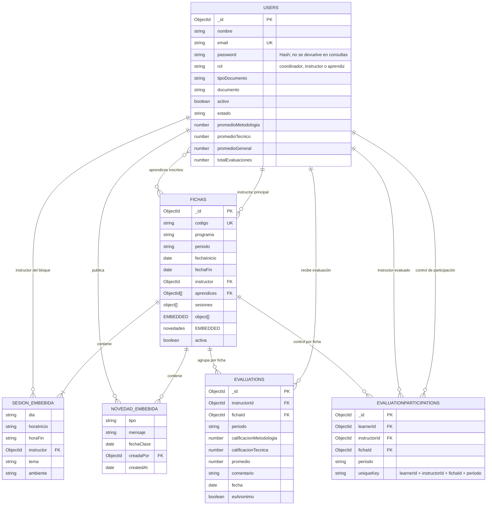

# Diagrama del modelo de datos MongoDB

Este diagrama describe las colecciones del backend y sus referencias. Es una
vista lógica tipo DER adaptada a MongoDB: `SESION_EMBEBIDA` y
`NOVEDAD_EMBEBIDA` no son colecciones independientes, sino subdocumentos que
se guardan dentro de `fichas`.

## Colecciones y reglas importantes

- **`users`** guarda las cuentas de los tres roles. `email` es único; la
  contraseña se almacena como hash. El documento del aprendiz es opcional en
  las cuentas normales y, cuando existe, se valida como único por tipo y
  número.
- **`fichas`** guarda la ficha, los aprendices inscritos y los bloques
  semanales. Cada sesión referencia a su instructor y conserva tema, horario y
  ambiente. Las novedades también se embeben en la ficha y guardan quién las
  publicó.
- **`evaluations`** contiene calificaciones y comentarios, pero no tiene
  `learnerId`. Por eso la respuesta queda separada de la identidad del aprendiz.
- **`evaluationparticipations`** registra por separado quién ya participó, sin
  calificaciones, comentario ni fecha. Un índice único con
  `learnerId + instructorId + fichaId + periodo` impide duplicar la evaluación
  del mismo instructor en esa ficha y periodo.
- Las respuestas de `evaluations` se consolidan para mostrarse cuando el grupo
  alcanza el mínimo configurado de cinco respuestas. La separación de
  colecciones reduce la vinculación directa, pero no equivale a anonimato
  absoluto frente a acceso administrativo o correlación de tiempos.

## Nota para la presentación académica

Si solicitan un DER, se puede presentar este diagrama como **modelo lógico
adaptado a documentos MongoDB**. Las relaciones marcadas con `FK` son
referencias `ObjectId` convencionales de Mongoose; MongoDB no aplica claves
foráneas automáticamente. Las sesiones y novedades son subdocumentos embebidos,
no tablas/colecciones normalizadas.
