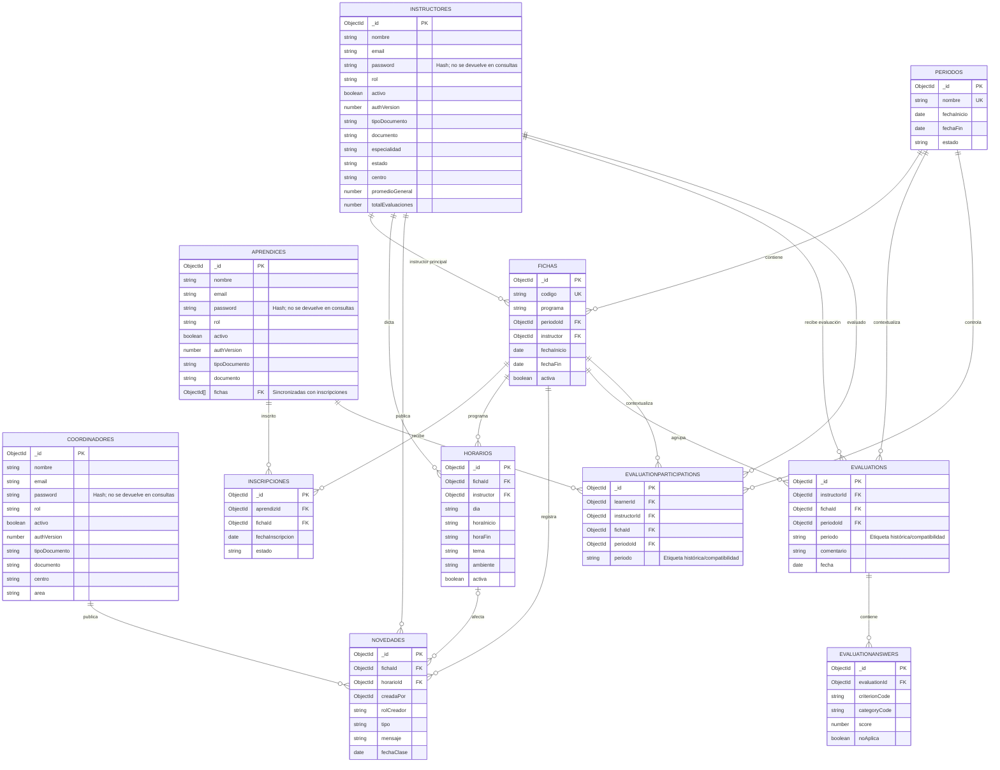

# Diagrama del modelo de datos MongoDB

Este diagrama describe las colecciones del backend y sus referencias. Las
perfiles por rol, periodos, inscripciones, horarios y novedades son
colecciones independientes; las evaluaciones, respuestas y participaciones
también permanecen separadas.

## Colecciones y reglas principales

- **`instructores`**, **`aprendices`** y **`coordinadores`** contienen cada uno
  los datos propios del rol y los datos de acceso: nombre, correo, hash de
  contraseña, rol, estado activo y versión de autenticación. La contraseña no
  se devuelve en las respuestas normales. El correo se valida como único entre
  roles en el servicio de usuarios; los documentos de instructor y
  coordinación son opcionales hasta que se ingresen sus valores reales.
- **`periodos`** contiene el nombre único del periodo y sus fechas/estado.
  Fichas y registros nuevos de evaluación apuntan a su `periodoId`; la etiqueta
  `periodo` permanece en evaluaciones/participaciones para compatibilidad con
  datos e índices existentes.
- **`fichas`** conserva código, programa, vigencia e instructor principal.
  Aprendices se vinculan mediante **`inscripciones`**; los bloques semanales
  viven en **`horarios`** y pueden tener instructores distintos.
  El perfil de aprendiz contiene también `fichas` como lista de referencias
  sincronizada con las inscripciones activas para facilitar su visualización.
- **`novedades`** son documentos independientes ligados a una ficha y,
  opcionalmente, a un horario. Guardan el ID y rol del instructor o coordinador
  que publicó el aviso; el ID se mantiene igual al migrar las cuentas.
- **`evaluations`** contiene la cabecera y comentario, sin identidad del
  aprendiz. **`evaluationanswers`** guarda la calificación (1 a 5) o la marca
  “No me consta / No aplica”. **`evaluationparticipations`** controla por
  separado el envío duplicado con un índice único.
- Los resultados se muestran cuando alcanzan cinco respuestas. Separar las
  colecciones reduce la vinculación directa, pero no garantiza anonimato
  absoluto frente a acceso administrativo o correlación de tiempos.

## Estado de migración

El backend ya usa los esquemas normalizados con autenticación dentro de cada
perfil. [La migración de cuentas](../backend/config/migrateAccountsIntoProfiles.js)
copia credenciales de la antigua colección `cuentas` a los perfiles, conserva
los IDs y permite eliminar `cuentas` solo después de verificar las copias.
La migración de roles copia directamente datos de una colección legacy `users`
y puede retirar esa colección con confirmación. Cuando hay datos académicos
embebidos, la migración de roles debe ejecutarse antes que
[la migración académica](../backend/config/migrateAcademicCollections.js),
porque las inscripciones y horarios referencian perfiles. Esta segunda
migración convierte los documentos embebidos y limpia esos campos de `fichas`;
haz un respaldo y pruébala primero en una copia no productiva. La base de
pruebas configurada ya tiene los 31 perfiles migrados y verificados; la
colección `cuentas` fue retirada. No se modificó producción.

Los documentos de materias, categorías, preguntas y versiones de rúbrica son
una posible ampliación; actualmente el tema continúa como texto del horario y
la rúbrica se define en configuración del backend.

## Nota para la presentación académica

Este es un **modelo lógico adaptado a documentos MongoDB**. Las relaciones
marcadas con `FK` son referencias `ObjectId` que valida la aplicación;
MongoDB no aplica claves foráneas automáticamente.
