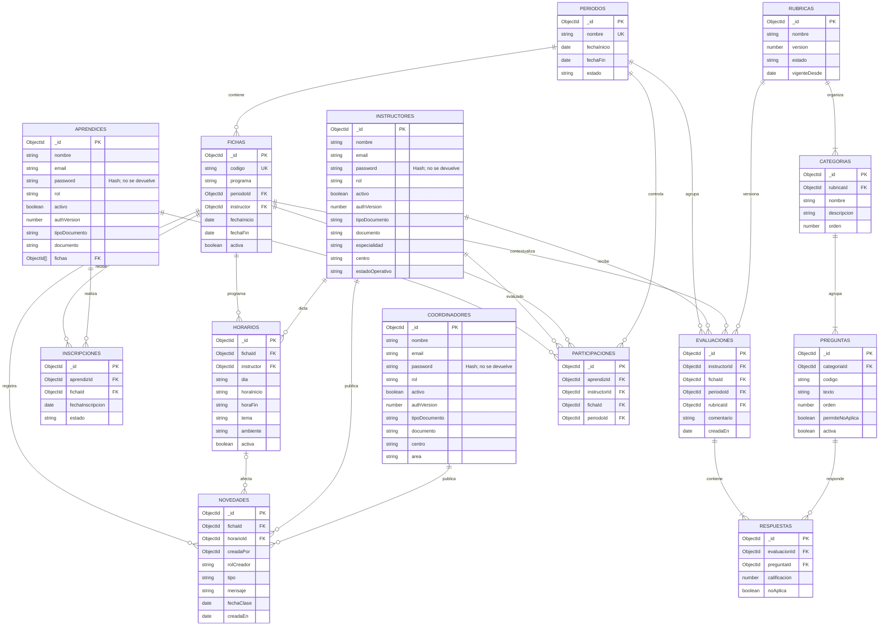

# Propuesta de modelo lógico con colecciones MongoDB

> **Estado:** el backend implementa perfiles por rol con datos de acceso,
> periodos, inscripciones, horarios, novedades y respuestas separadas de la
> rúbrica. La base de pruebas configurada ya migró y verificó los 31 perfiles,
> y retiró la colección antigua `cuentas`; producción no se modificó. La
> colección de materias y los catálogos editables para rúbricas siguen siendo
> propuestas.

La propuesta separa las entidades que se quieren consultar y gestionar
independientemente. Cada nombre del diagrama representa **una colección con
muchos documentos**, no una colección por persona. Por ejemplo, `instructores`
contendría un documento por instructor.

## Diagrama

## Colecciones propuestas

| Colección | Propósito |
|---|---|
| `instructores` | Perfil y acceso del instructor: nombre, correo, hash de contraseña, rol, estado e identidad opcional. |
| `aprendices` | Perfil y acceso del aprendiz, documento y referencias a fichas inscritas. |
| `coordinadores` | Perfil y acceso del coordinador e identidad opcional. |
| `periodos` | Periodos académicos reutilizados por fichas, evaluaciones y participaciones. |
| `fichas` | Identificación, programa y vigencia de cada grupo de formación. |
| `inscripciones` | Relación muchos a muchos entre aprendices y fichas. |
| `horarios` | Sesiones individuales con ficha, instructor, día, horas, tema y ambiente. |
| `novedades` | Cancelaciones, cambios y avisos generales, cada uno como documento consultable. |
| `rubricas` | Nombre, versión y vigencia del instrumento de evaluación. |
| `categorias` | Agrupaciones temáticas de los criterios de una rúbrica. |
| `preguntas` | Criterios de la rúbrica que responderán los aprendices. |
| `evaluaciones` | Cabecera de la evaluación por instructor, ficha, periodo y versión de rúbrica; no guarda `aprendizId` ni incluye evaluaciones de coordinación. |
| `respuestas` | Una respuesta por pregunta de una evaluación, con calificación o indicación de “No aplica”. |
| `participaciones` | Control independiente para permitir como máximo una evaluación por aprendiz, instructor, ficha y periodo. No guarda respuestas ni referencia a la evaluación. |

## Criterios de la rúbrica propuesta

La rúbrica implementada tiene tres categorías y ocho preguntas:

| Categoría | Criterio |
|---|---|
| Competencias pedagógicas y didácticas | Dominio técnico y conceptual |
| Competencias pedagógicas y didácticas | Metodología y estrategias |
| Competencias pedagógicas y didácticas | Claridad en la evaluación |
| Competencias comunicativas y relacionales | Claridad en la comunicación |
| Competencias comunicativas y relacionales | Escucha activa y receptividad |
| Competencias comunicativas y relacionales | Respeto e inclusión |
| Compromiso institucional y cumplimiento | Puntualidad y asistencia |
| Compromiso institucional y cumplimiento | Gestión del ambiente de aprendizaje |

Cada criterio se califica con un entero de 1 a 5 o se marca “No me consta / No
aplica”. Coordinación administra todas las fichas y puede consultar resultados
consolidados, pero no responde evaluaciones. El criterio de oportunidad de notas
y reportes administrativos se excluye del formulario del aprendiz por no ser
verificable desde su rol.

En la implementación actual, cada respuesta es un documento de
`evaluationanswers`, identificado por evaluación y código de criterio. La
participación que previene duplicados se conserva en una colección separada y
no contiene la evaluación ni sus respuestas.

## Relaciones y reglas de integridad

- **Acceso y perfiles:** las credenciales se guardan en el documento del rol
  correspondiente. El campo `password` contiene únicamente el hash scrypt y
  se excluye de las respuestas de la API. El correo se valida como único entre
  roles por el servicio; cada perfil tiene un solo rol. `aprendices.fichas` es
  una lista de referencias sincronizada con las inscripciones activas.
- **Aprendices y fichas:** la relación muchos a muchos se representa con
  `inscripciones`. Un índice único compuesto `{ aprendizId, fichaId }` evita
  duplicar la inscripción vigente.
- **Ficha e instructores:** se deriva de `horarios`, que permite varios bloques,
  materias e instructores dentro de una misma ficha.
- **Evaluaciones:** cada evaluación corresponde a un instructor, ficha, periodo
  y versión de rúbrica; solo la puede enviar un aprendiz inscrito. Las
  respuestas se guardan en documentos aparte.
- **Duplicados:** un índice único compuesto en `participaciones` sobre
  `{ aprendizId, instructorId, fichaId, periodoId }` impide una segunda
  participación para esa combinación. La colección no contiene `evaluacionId`,
  respuestas ni comentario.
- **Respuestas:** un índice único compuesto `{ evaluacionId, preguntaId }`
  evita responder dos veces la misma pregunta dentro de una evaluación.
- **Índices:** las claves compuestas únicas se definen como índices MongoDB;
  no son campos concatenados que haya que guardar en cada documento.
- **Preguntas históricas:** una rúbrica publicada debe ser inmutable. Si cambia
  una pregunta, se crea una nueva versión de la rúbrica para que las
  evaluaciones pasadas sigan interpretándose correctamente.
- **Horarios:** el servicio debe validar que la hora final sea posterior a la
  inicial y que no existan traslapes incompatibles para la ficha/instructor.
- **Novedades:** `horarioId` puede ser nulo cuando el aviso afecte a toda la
  ficha; `creadaPor` y `rolCreador` identifican al coordinador o instructor
  responsable.
- **Coordinadores:** cualquier coordinador puede administrar todas las fichas.
  Su perfil es administrativo y no participa como evaluador.
- **Promedios:** se calculan desde `respuestas` y se publican agrupados por
  instructor, ficha, periodo, rúbrica y categoría. Se recomienda conservar el
  umbral mínimo de cinco participaciones antes de mostrar resultados agregados.

## Consideraciones para MongoDB

Los `ObjectId` señalados como `FK` son referencias entre colecciones; MongoDB no
los valida como claves foráneas relacionales. La API debe comprobar que las
referencias existan y que los roles y relaciones sean correctos. Los índices
únicos ayudan a prevenir duplicados, pero no reemplazan las validaciones de
negocio.

La separación lógica no significa una colección por persona ni por atributo.
Por ejemplo, todos los horarios se guardan en la colección `horarios`, con un
documento por sesión.

## Diferencia con el modelo implementado

El modelo actualmente implementado ya usa colecciones de perfiles y datos de
acceso integrados, además de inscripciones, horarios, novedades, periodos y
respuestas separadas. Las materias y los catálogos editables para la rúbrica
siguen siendo una posible ampliación. La migración desde una base existente
debe probarse primero en una copia no productiva.
